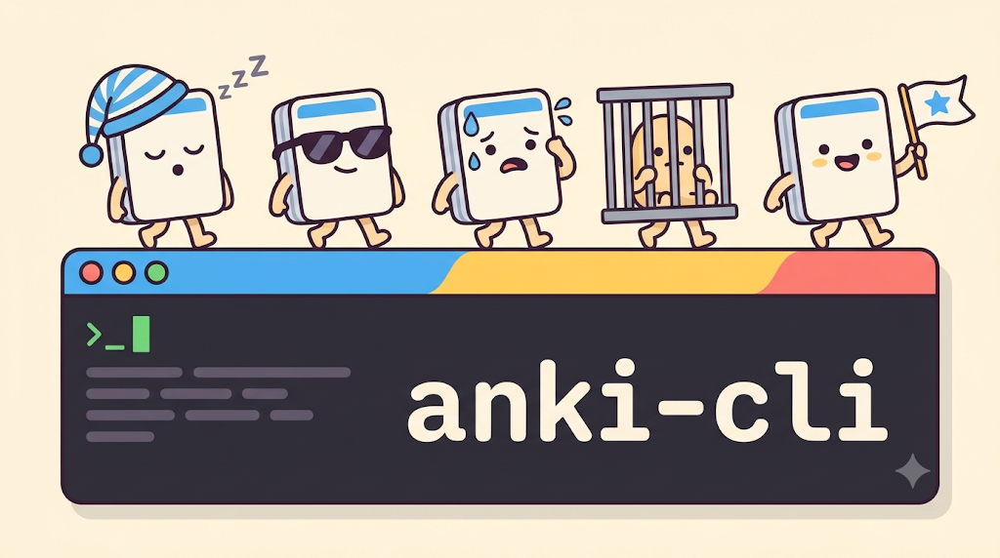

<p align="center">
  
</p>

<p align="center">Manage and study your Anki flashcards from the terminal — as a person at a keyboard, or as an AI agent reading JSON.</p>

<p align="center">
  <a href="https://github.com/ubermenchh/anki-cli/actions/workflows/ci.yml"></a>
  <a href="https://pypi.org/project/anki-cli/"></a>
  <a href="https://pypi.org/project/anki-cli/"></a>
  <a href="https://pepy.tech/projects/anki-cli"></a>
  <a href="LICENSE"></a>
  <a href="https://github.com/astral-sh/ruff"></a>
</p>

<p align="center">
  
</p>

## About

`anki-cli` is a command-line client for [Anki](https://apps.ankiweb.net/). It lets you
search, add, edit, tag, move and review cards without opening the Anki window, and gives
you a full-screen terminal app for browsing and studying.

- **Two backends.** Talk to a running Anki Desktop through the
  [AnkiConnect](https://ankiweb.net/shared/info/2055492159) add-on, or read and write the
  collection file directly when Anki is closed. `auto` picks the right one for you.
- **Anki's search language.** `deck:`, `tag:`, `is:due`, `prop:ivl>30`, `OR`, `-`, and
  parentheses work the way they do in Anki's browser.
- **Built for scripts and agents.** Every command can print JSON (`--format json`) with a
  stable envelope and documented exit codes. A [`SKILL.md`](SKILL.md) teaches AI coding
  agents how to use it.
- **Interactive when you want it.** A REPL with autocomplete, a card browser, and a
  review screen with FSRS scheduling.

> **Status:** alpha. Back up your collection before running write commands in direct mode.

## Contents

- [Requirements](#requirements)
- [Install](#install)
- [Set up a backend](#set-up-a-backend)
- [First steps](#first-steps)
- [Interactive modes](#interactive-modes)
- [Configuration](#configuration)
- [Search query language](#search-query-language)
- [Command reference](#common-commands)
- [Output and exit codes](#output-and-exit-codes)
- [AI agent integration](#ai-agent-integration)
- [Troubleshooting](#troubleshooting)
- [Development](#development)

## Requirements

- Python 3.12 or 3.13
- [uv](https://docs.astral.sh/uv/) (recommended) or [pipx](https://pipx.pypa.io/)
- [Anki Desktop](https://apps.ankiweb.net/) with at least one profile, so a collection file exists
- For the AnkiConnect backend: the [AnkiConnect](https://ankiweb.net/shared/info/2055492159) add-on

macOS, Linux (including Flatpak and Snap installs of Anki) and Windows are supported.

## Install

```bash
# Core CLI
uv tool install anki-cli

# Core CLI + the interactive REPL, card browser and review screen
uv tool install "anki-cli[tui]"
```

With pipx: `pipx install "anki-cli[tui]"`. Check it worked:

```bash
anki --version
```

To upgrade later: `uv tool upgrade anki-cli` (or `pipx upgrade anki-cli`).

## Set up a backend

`anki-cli` needs to reach your collection one of two ways. You only need one.

| | AnkiConnect | Direct |
|---|---|---|
| How it works | HTTP calls to the AnkiConnect add-on inside Anki Desktop | Opens `collection.anki2` with SQLite |
| Anki Desktop | Must be **running** | Must be **closed** |
| Sync with AnkiWeb | Anki syncs as usual | Sync from Anki Desktop afterwards |
| Supports | Everything except `card:bury`, `card:unbury`, `review:undo` and the TUI review screen | Everything |
| Best for | Day-to-day use alongside Anki | Scripts, servers, studying in the terminal |

### Option A: AnkiConnect (Anki running)

1. In Anki Desktop open **Tools ▸ Add-ons ▸ Get Add-ons…**, enter code `2055492159`, and click OK.
2. Restart Anki and leave it open.
3. Check the connection:

   ```bash
   anki status
   ```

   The `backend` column should say `ankiconnect`. AnkiConnect listens on `http://localhost:8765` by default.

### Option B: Direct (Anki closed)

1. Quit Anki Desktop. The direct backend refuses to run while Anki has the collection open.
2. Run `anki status`. It finds the collection on its own in the usual places:

   | OS | Default Anki data folder |
   |---|---|
   | macOS | `~/Library/Application Support/Anki2/` |
   | Linux | `~/.local/share/Anki2/` (also Flatpak and Snap locations) |
   | Windows | `%APPDATA%\Anki2\` |

3. If you have several profiles, or keep the collection somewhere else, point at it:

   ```bash
   anki config:set --key collection.anki_profile --value "Work"
   anki config:set --key collection.path --value "/path/to/collection.anki2"
   anki --col "/path/to/collection.anki2" status   # one-off override
   ```

With the default `auto` backend, `anki-cli` tries AnkiConnect first and falls back to the
collection file, so after either setup most commands just work.

## First steps

```bash
anki status                                  # which backend and collection are in use
anki decks                                   # every deck with new / learning / review counts
anki cards --query "deck:Default is:due" --limit 5
anki note:add --deck "Default" --notetype "Basic" --Front "What is FSRS?" --Back "Anki's scheduler"
anki notes --query "FSRS"                    # find it again
anki review --deck "Default"                 # due counts for one deck
```

Notetype fields become options: a "Basic" note takes `--Front` and `--Back`; run
`anki --format json notetype --notetype "Basic"` to see the fields of any notetype.

Add `--format json` to any command for machine-readable output, and `--help` to any
command for its options:

```bash
anki --format json decks
anki card:move --help
```

`status` always exits 0 — it reports probe results in `data.ok`/`data.error`
rather than failing, so it works as a health check on hosts with no Anki.

## Interactive modes

These need the `tui` extra (see [Install](#install)).

| Command | What it opens |
|---|---|
| `anki` or `anki shell` | REPL with command autocomplete and due counts in the header |
| `anki browse --query "tag:verb"` | Card browser for a search |
| `anki review:start --deck "Japanese"` | Review screen (direct backend) |

### TUI themes

Both TUIs (`browse`, `review:start`) follow the active [Textual theme](https://textual.textualize.io/guide/design/).
Press `ctrl+p` and pick "Change theme"; the choice is saved to `display.theme` and used next time.
You can also set it directly:

```bash
anki config:set --key display.theme --value nord
```

The default is `anki-tokyo-night`; any built-in Textual theme name works. `--no-color` (or
`display.color = false`) uses the terminal's own palette instead and does not change the saved theme.

## Configuration

Settings live in `~/.config/anki-cli/config.toml`. You do not need the file to get
started; every key has a default.

```bash
anki config                                    # show the current settings
anki config:path                               # where the file is
anki config:set --key display.default_output --value json
```

| Key | Default | Meaning |
|---|---|---|
| `backend.prefer` | `auto` | `auto`, `ankiconnect` or `direct` |
| `backend.ankiconnect_url` | `http://localhost:8765` | Where AnkiConnect listens |
| `backend.allow_non_localhost` | `false` | Allow a remote `ankiconnect_url` (see below) |
| `collection.path` | unset | Explicit path to `collection.anki2` |
| `collection.anki_profile` | unset | Anki profile to use when there are several |
| `display.default_output` | `table` | `table`, `json`, `md`, `csv` or `plain` |
| `display.color` | `true` | Colour output |
| `display.theme` | `anki-tokyo-night` | TUI theme |

Environment variables override the file, and command-line flags override both:

| Variable | Overrides |
|---|---|
| `ANKI_CLI_BACKEND` | `backend.prefer` / `--backend` |
| `ANKI_CLI_COLLECTION` | `collection.path` / `--col` |
| `ANKI_CLI_OUTPUT` | `display.default_output` / `--format` |
| `ANKI_CLI_COLOR` | `display.color` / `--no-color` |
| `ANKI_CLI_DEBUG` | Set to `1` to print a traceback after an internal error |

### Backend modes

Global backend selection:

```bash
anki --backend auto ...
anki --backend ankiconnect ...
anki --backend direct ...
```

Collection override (direct backend):

```bash
anki --backend direct --col "/path/to/collection.anki2" status
```

Anki profile selection (for multi-profile installs):

```toml
# ~/.config/anki-cli/config.toml
[collection]
anki_profile = "Work"
```

When set, collection discovery picks `<Anki2>/<anki_profile>/collection.anki2`
instead of the first profile found. A name matching no profile exits with code
3 and lists the available profiles — but only where a local collection is
actually required: on the AnkiConnect path the lookup is informational and a
miss never fails. `--col` takes precedence over it entirely.

Backend behavior:

- `auto`: uses AnkiConnect if it answers, otherwise the collection file
- `ankiconnect`: forwards search queries to `findCards` and `findNotes`
- `direct`: compiles queries to SQL and executes directly on the collection DB

The old `standalone` backend was removed: `prefer = "standalone"` in
`config.toml` and `ANKI_CLI_BACKEND=standalone` warn and run as `auto`;
`--backend standalone` is rejected at the CLI with a usage error (exit 2).

### Remote AnkiConnect

To connect to AnkiConnect running on a different machine (e.g. via Tailscale or LAN):

```toml
# ~/.config/anki-cli/config.toml
[backend]
prefer = "ankiconnect"
ankiconnect_url = "http://192.168.1.100:8765"
allow_non_localhost = true
```

The remote Anki Desktop must have AnkiConnect configured to accept non-localhost connections. Set `"webBindAddress"` to a specific interface address (e.g. your Tailscale IP) or `"0.0.0.0"` for all interfaces. If binding to all interfaces, consider restricting access with firewall rules.

Without `allow_non_localhost = true` the remote URL is never contacted — the
detection probe and all data operations refuse non-localhost hosts.

## Search query language

Filters follow Anki's own semantics:

- `deck:NAME` — the deck and its subdecks (`deck:Lang` covers `Lang::Spanish`), including cards visiting a filtered deck; `deck:*` (all), `deck:filtered` (cards in filtered decks); supports `*` glob. Name matching is case-insensitive for ASCII.
- `notetype:NAME` (or Anki's spelling `note:NAME`)
- `tag:NAME` — the tag and its children (`tag:verb` covers `verb::irregular`); `tag:none` for untagged notes, `tag:*` for every note; supports `*` glob
- `is:new` / `is:review` (by card type, so a suspended new card is still `is:new`), `is:learn`, `is:due` (learning/review cards whose due time has passed; never new cards), `is:suspended`, `is:buried`
- `added:N` — cards created in the last N scheduling days (`added:1` = since the last rollover)
- `flag:N`
- `prop:ivl>N`, `prop:due>N`, `prop:reps>N`, `prop:lapses>N` (`<`, `<=`, `=`, `>=`, `>`)
- `nid:ID`, `cid:ID`
- bare text and quoted text (`"specific text"`); escape a literal colon as `\:`

Any other `prefix:` (for example `card:`, `rated:`, `mid:`, `deck:current`, field searches like
`front:dog`) is rejected with `INVALID_INPUT` rather than silently searched as text.

The `--deck` option on `review`, `decks` and `deck` follows the same rule: it covers the named deck
and its subdecks, so a parent row in `decks` includes its children's counts.

Logical syntax:

- implicit `AND` from whitespace
- explicit `OR`
- unary `-` and `NOT`
- parentheses for grouping

Examples:

```bash
anki cards --query "deck:Japanese is:due"
anki cards --query "tag:verb -is:suspended"
anki notes --query "\"specific text\""
anki cards --query "(tag:a OR tag:b) is:new"
```

## Common Commands

### Cards

```bash
anki cards --query "deck:Default"          # details for every match
anki cards:ids --query "deck:Default"      # ids only
anki card --id 123
anki card:suspend --query "is:due"
anki card:unsuspend --id 123
anki card:move --query "tag:to-move" --deck "Archive"
anki card:flag --query "is:review" --flag 3
anki card:bury --query "deck:Default"        # direct backend only
anki card:unbury --deck "Default"           # direct backend only
anki card:reschedule --query "tag:reset-me" --days 3
anki card:reset --query "tag:relearn"
anki card:revlog --id 123 --limit 20
```

### Notes and tags

```bash
anki notes --query "deck:Default"
anki note --id 123
anki note:add --deck "Default" --notetype "Basic" --Front "Q" --Back "A"
anki note:add --deck "Default" --notetype "Basic" --Front "Q" --Back "A2" --allow-duplicate
anki note:edit --id 123 --Front "Updated Q" --Back "Updated A"
anki note:fields --id 123
anki note:delete --id 123 --yes
anki tag --tag "verb"
anki tag:add --query "deck:Default" --tag "important"
anki tag:remove --id 123 --tag "important"
anki tag:rename --from "old" --to "new"
```

Like Anki's own Add dialog, `note:add` refuses a note whose first field already exists in
the same notetype (exit 1) or is empty. `--allow-duplicate` lifts the duplicate check; it
also works on `note:bulk`, where refused items otherwise come back as `null` ids.

### Decks and notetypes

```bash
anki deck --deck "Default"
anki deck:create --deck "Japanese::Vocab"
anki deck:rename --from "Old" --to "New"
anki deck:delete --deck "Temporary" --yes
anki deck:config --deck "Default"
anki deck:config:set --deck "Default" --new-per-day 20 --reviews-per-day 200

anki notetypes
anki notetype --notetype "Basic"
anki notetype:create --notetype "MyType" --field "Front" --field "Back"
anki notetype:field:add --notetype "Basic" --field "Extra"
anki --yes notetype:field:remove --notetype "Basic" --field "Extra"   # deletes the field from every note
anki notetype:css --notetype "Basic" --set ".card { font-size: 18px; }"
```

### Review

```bash
anki review
anki review:next
anki review:show
anki review:preview --id 123
anki review:answer --id 123 --rating good
anki review:undo
```

Interactive TUI review (requires TUI extras, direct backend):

```bash
anki review:start --deck "Japanese"
```

## Output and Exit Codes

Global output formats:

```bash
anki --format json ...
anki --format table ...
anki --format md ...
anki --format csv ...
anki --format plain ...
```

Every command names its target the same way: `--deck`, `--notetype`, `--tag`, `--id`,
`--query`; `--field` is repeatable. Older spellings (`deck:create --name`,
`notetype:create --name`, `tag:add --tags`, `note:fields --fields a,b`) still work as
aliases. `anki commands --format json` lists every command, option, exit and error code.

Global options (`--format`, `--backend`, `--col`, `--yes`, `--copy`, `--no-color`) may be
written before or after the subcommand: `anki --yes note:delete --id 1` and
`anki note:delete --id 1 --yes` are the same command.

Every failure — including a mistyped option or command name — is reported through the
same envelope, so `--format json` always yields parseable stderr. Set `ANKI_CLI_DEBUG=1`
to append a Python traceback after an `INTERNAL_ERROR` envelope.

Exit codes:

- `0`: Success
- `1`: Backend operation failed (including unexpected errors)
- `2`: Invalid input, usage error, confirmation required, or unsupported operation
- `3`: No Anki backend found (auto mode could not reach AnkiConnect or find a collection)
- `4`: Entity not found
- `7`: Backend unavailable or collection locked
- `130`: Interrupted (Ctrl-C)

`status` is the exception: it reports detection failures as
`{"ok": true, "data": {"ok": false, "error": "..."}}` and still exits 0.

## AI Agent Integration

This repo ships a [`SKILL.md`](SKILL.md) at the project root — an [agent skill](https://agentskills.io) that AI coding agents can consume to operate `anki-cli` without human guidance. It covers the full command reference, JSON output structure, search query syntax, error codes, and common workflows.

### Any supported agent (recommended)

```bash
npx skills add ubermenchh/anki-cli
```

Automatically detects your installed agents and places the skill in the correct directory. Works with Claude Code, Codex, Cursor, Copilot, OpenCode, and others.

### Manual

Copy or symlink `SKILL.md` into your agent's skills directory:

| Agent | Skill directory |
|-------|-----------------|
| Claude Code | `~/.claude/skills/anki-cli/SKILL.md` |
| Codex | `~/.codex/skills/anki-cli/SKILL.md` |
| Cursor | `~/.cursor/skills/anki-cli/SKILL.md` |
| OpenCode | `~/.agents/skills/anki-cli/SKILL.md` |
| Project-level (any) | `.agents/skills/anki-cli/SKILL.md` |

```bash
mkdir -p ~/.claude/skills/anki-cli
cp SKILL.md ~/.claude/skills/anki-cli/SKILL.md
```

For other AI coding agents, point them at `SKILL.md` in the repo root or include it in your agent's context/system prompt.

## Safety Notes

- Use `--yes` for destructive operations (`note:delete`, `deck:delete`, `notetype:field:remove`).
- In direct mode, avoid write operations while Anki Desktop is open.
- If Anki Desktop is running, prefer `--backend ankiconnect`.
- `review:undo` (direct mode only) restores the card's previous state and deletes the revlog row written by the undone answer, matching Anki's own undo.
- In direct mode, `csum` for notes with HTML in the first field now matches Anki. Rows written by older anki-cli versions keep their old csum until Tools ▸ Check Database recomputes them; duplicate detection may miss them until then.

## Troubleshooting

| Symptom | Fix |
|---|---|
| Exit 3, "No AnkiConnect and no collection found" | Start Anki with AnkiConnect installed, or point at the file with `--col` / `collection.path`. |
| Exit 7, "Anki is running but AnkiConnect is unavailable" | Install AnkiConnect (code `2055492159`) and restart Anki, or quit Anki to use the direct backend. |
| Exit 3 listing profile names | `collection.anki_profile` does not match a profile; pick one from the list. |
| `TUI_NOT_AVAILABLE` | Reinstall with the extra: `uv tool install --force "anki-cli[tui]"`. |
| `review:start` refuses to run | The review screen needs the direct backend: quit Anki and run it again. |
| Remote AnkiConnect is never contacted | Set `backend.allow_non_localhost = true`. |

`anki status` shows which backend was picked and why. For a bug report, include its
output and, if you saw `INTERNAL_ERROR`, the traceback from `ANKI_CLI_DEBUG=1`.

## Development

```bash
uv sync --group dev
uv run ruff check .
uv run ty check
uv run pytest
```

With optional TUI dependencies:

```bash
uv sync --group dev --extra tui
uv run pytest -m tui
```

### Adding a command

Commands live in `anki_cli/cli/commands/` and are declared with `@anki_command`
(`anki_cli/cli/command.py`), which owns the output envelope, the backend session, and
`BACKEND_UNAVAILABLE`. The body returns the success `data` and declares which other
exceptions become which error code:

```python
@anki_command("deck", errors={LookupError: ("ENTITY_NOT_FOUND", 4)})
@click.option("--deck", "deck_name", required=True)
def deck_cmd(cmd: CommandContext, deck_name: str) -> JSONValue:
    name = deck_name.strip()
    if not name:
        raise cmd.invalid("Deck name cannot be empty.")
    with cmd.errors(details={"deck": name}):
        return cmd.backend.get_deck(name)
```

Anything not mapped falls through to the entry-point mapper, which still renders an
envelope. `anki commands --format json` lists the result; the docs-sync tests check that
README and SKILL.md only mention commands and options that exist.

## License

MIT. See `LICENSE`.